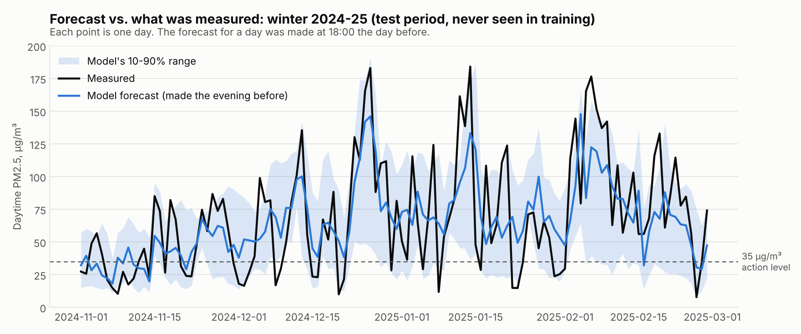

# Smog Tomorrow: should tomorrow's PE lesson be outdoors?

**Track:** AI + Climate · **Team:** Bakdaulet (solo)

**Demo video (2 min, captions):** [`docs/demo_video.mp4`](docs/demo_video.mp4) · **Notebook with saved outputs:** [`notebooks/SmogTomorrow.ipynb`](notebooks/SmogTomorrow.ipynb) · [open in Colab](https://colab.research.google.com/github/yk59m2cmhw-hash/c/blob/claude/sleepy-mendel-te40eu/notebooks/SmogTomorrow.ipynb) · **All results:** [`results/RESULTS.md`](results/RESULTS.md)

## The problem

Almaty, Kazakhstan, lies at the foot of high mountains, and in the heating season smoke gets trapped over the city. At the monitor we use, daytime PM2.5 was above 35 µg/m³ on 119 of 398 measured days between October 2024 and November 2025, all but two of them from October to March. A PE teacher has to decide the evening before whether tomorrow's lessons can be outdoors, and the simplest guess is that tomorrow will be like today.

## What we built

Every evening at 18:00 the tool forecasts tomorrow's school hours (08:00–18:00): the expected PM2.5, a likely range, a plain decision (**PE indoors** or **PE outdoors**) and the three inputs that moved the forecast most. It has two models built by the same code:

- **Main model:** uses today's PM2.5 readings and airport weather. In the demo you pick an evening from the test period and see the forecast next to what was measured the next day.
- **Sensor-free model:** uses airport weather only, so it needs no PM2.5 monitor and runs today. `python src/live.py`, or the first tab of the demo, downloads the latest airport reports and forecasts the real tomorrow.

> **Replay, evening of 16 Dec 2024:** today was clean (23 µg/m³). Forecast: about 63 µg/m³, likely 39–113, ⚠️ smog warning. Measured the next day: 67 µg/m³.
>
> **Live, evening of 15 Nov 2026, no PM2.5 input:** forecast for Monday 16 Nov: about 57 µg/m³, likely 25–86, ⚠️ smog warning. We cannot check this one against the reference monitor.

## What we added

We started from suggested project **4.3.2 Next-day air quality forecast** and added:

- **Our own place and user:** Almaty, a school, and a target that matches the decision: the mean over school hours, forecast at 18:00 from data that already exists.
- **Question 1: is a free global forecast enough for Almaty?** No. The CAMS global model reads 13.6 µg/m³ too low here; with the plain rule "warn above 35" it would have warned on only 47 of 119 smog days.
- **Question 2: can a school get a useful warning with no PM2.5 monitor?** The public record of the monitor we trained on ends on 14 November 2025, so the main model cannot be run for the real tomorrow. A model that sees only airport weather and the calendar does almost as well, and it is the one that forecasts the real tomorrow.
- **Question 3: what happens on the days the air changes?** "Tomorrow = today" is wrong on every one of them. Our models are right on about half, which is no better than a monthly average.
- **A stated decision rule and a locked test.** A missed smog day counts three times a false alarm, and every warning threshold was chosen on validation data with that rule. Settings were committed to git before each model was scored on the test period (`7f98623`, `37fb006`).

## How it works

**Data.** 34,534 hourly PM2.5 readings (Apr 2020 – Nov 2025) from a reference-grade monitor in Almaty and 126,509 weather reports from Almaty airport. A day counts only if at least 6 of its 10 daytime hours were measured; outage days are dropped, not filled in. This leaves 1,348 evening-to-next-day pairs.

**Model.** Gradient-boosted decision trees (scikit-learn) on 30 inputs: recent PM2.5, airport weather (wind, temperature, pressure, visibility, rain or snow, fog) and the calendar. Trees fit here because the effect of weather is not a straight line and some readings are missing. The sensor-free model is the same model given only the 21 weather and calendar inputs.

**Split by date, never shuffled.** Train to Sep 2023 (598 days), validation Oct 2023 – Sep 2024 (352 days, used for every choice), test Oct 2024 – Nov 2025 (398 days).

## Results

Test period: 398 days, 119 smog days. MAE is the average miss in µg/m³. Cost = 3 × missed + false alarms.

| Method | Needs a PM2.5 monitor | MAE | Smog days missed | False alarms | Cost |
|---|---|---|---|---|---|
| Baseline: tomorrow = today | yes | 15.3 | 11 | 76 | 109 |
| Global model (CAMS) | no | 16.6 | 9 | 83 | 110 |
| Linear model | yes | 13.1 | 21 | 45 | 108 |
| **Our main model** | yes | **12.3** | 16 | 52 | 100 |
| **Our sensor-free model** | **no** | 13.2 | 19 | 40 | 97 |

- **Main model.** Our baseline scored 15.3 and our model 12.3 on held-out test data, 20% lower (95% interval for the gain: 1.7 to 4.5). It raises a third fewer false alarms than the baseline but **misses more smog days, 16 against 11**, so by our cost rule it is only modestly ahead.
- **Sensor-free model.** 13.2 with no PM2.5 input, 14% lower than a baseline that needs a monitor (interval 0.5 to 3.7). It misses the most smog days (19) and raises the fewest false alarms (40). Knowing today's PM2.5 improves the number, but most of the warning comes from the weather.
- **Caveats.** The warning counts depend on the threshold; a sweep is in [`results/RESULTS.md`](results/RESULTS.md). The sensor-free model was scored after the main model, so it was a second look at the same test period; none of its settings used it. On the 69 days when the air crossed the 35 line, the main model was on the right side 36 times, the sensor-free model 40 and a plain monthly average 35.



**Where it fails.** The eight largest misses are all in January–February 2025, when PM2.5 doubled or halved overnight (80 → 165; 184 → 48). Wind at the airport was about 2 m/s on both days with no rain or snow, so nothing in our inputs announced the change. We think the cause is the temperature inversion above the city forming or breaking, which a ground station 14 km away cannot see; a weather-balloon study of Almaty found that the most polluted cold-season days come with a shallow mixing layer and calm winds ([Tursumbayeva et al., 2022](https://doi.org/10.4209/aaqr.210294)). Neither model knows anything about tomorrow's weather. The live forecast has a second limit: with no public reference data for 2026 we cannot score it, so the 2024–25 test is our only evidence for how far to trust it.

## What we'd do next

- Add tomorrow's weather forecast and weather-balloon data so the model can see inversions, then check whether the January misses shrink.
- Score the live forecasts through this winter against citizen sensors in Almaty, and try the warning with PE teachers at one school for a month.

## Sources

- **PM2.5:** OpenAQ public data archive, location [8876 "Almaty"](https://explore.openaq.org/locations/8876), provider AirNow ([archive docs](https://docs.openaq.org/aws/about)).
- **Weather:** Iowa Environmental Mesonet [ASOS/METAR archive](https://mesonet.agron.iastate.edu/request/download.phtml), station UAAA.
- **Global model:** CAMS global forecasts (Copernicus Atmosphere Monitoring Service) through the [Open-Meteo Air Quality API](https://open-meteo.com/en/docs/air-quality-api).
- **Background reading:** Tursumbayeva, Kerimray, Karaca and Permadi (2022), "Planetary Boundary Layer and its Relationship with PM2.5 Concentrations in Almaty, Kazakhstan", *Aerosol and Air Quality Research* 22(8), [doi:10.4209/aaqr.210294](https://doi.org/10.4209/aaqr.210294). We read the abstract, not the full paper.
- **Libraries:** pandas, NumPy, scikit-learn, matplotlib, Gradio. **Starting point:** Veritas AI project brief 4.3.2.
- **AI tools:** Claude Code (Anthropic), an AI coding agent. It did most of the engineering: it found the data sources, wrote the code, ran the experiments and drafted this write-up. I set the task and its rules (one real user, public data only, a fair baseline, a test period locked before scoring, honest reporting), reviewed the results, and can explain every step.

---

## Run it yourself

No API key, no GPU, about one minute.

```bash
pip install -r requirements.txt
python src/run_experiment.py     # rebuilds every number and figure in results/
python src/live.py               # forecasts the real tomorrow from fresh airport weather
python app.py                    # opens the demo page
```

The reported numbers use scikit-learn 1.9.1, pinned in `requirements.txt`. Other versions build slightly different trees, so a few borderline days can move.

`python src/download_data.py` fetches the raw data again from the original sources; the copies used for the reported numbers are in `data/raw/`.

| Path | What it is |
|---|---|
| `src/download_data.py` | downloads all data |
| `src/almaty_air.py` | features, baselines, models, metrics |
| `src/run_experiment.py` | the whole experiment → `results/` |
| `src/live.py` | the sensor-free forecast for the real tomorrow → `results/live_forecast.json` |
| `src/demo.py`, `app.py` | the demo page |
| `notebooks/SmogTomorrow.ipynb` | the same steps as a notebook, outputs saved |
| `PROJECT_SPEC.md` | the evaluation protocol, written before each model was scored on the test period |
| `tests/test_no_leakage.py` | deletes all data after 18:00 for 40 evenings and confirms no model input changes |
| `tests/test_live_forecast.py` | confirms the live forecast builds the same inputs as the experiment and uses nothing after 18:00 |
| `docs/` | notes for the author (in Russian) |

**Assumptions worth knowing**

- OpenAQ timestamps are treated as the end of each hourly average. If they marked the start, the forecast would in effect be issued at 19:00 instead of 18:00; the target (08:00–18:00 the next day) would still lie entirely in the future.
- The CAMS values come from Open-Meteo's archive, which keeps the freshest model runs, so they are somewhat better than a true day-ahead CAMS forecast. This favours CAMS in the comparison.
- The warning thresholds were chosen once, on validation data. The threshold sweep on the test days was added afterwards as a descriptive check and is labelled as such in `results/RESULTS.md`.
- The live forecast is made by the sensor-free model trained on all 1,449 days that have a reference measurement the next day, including the test period. The scores above are for the version trained without the test period.
