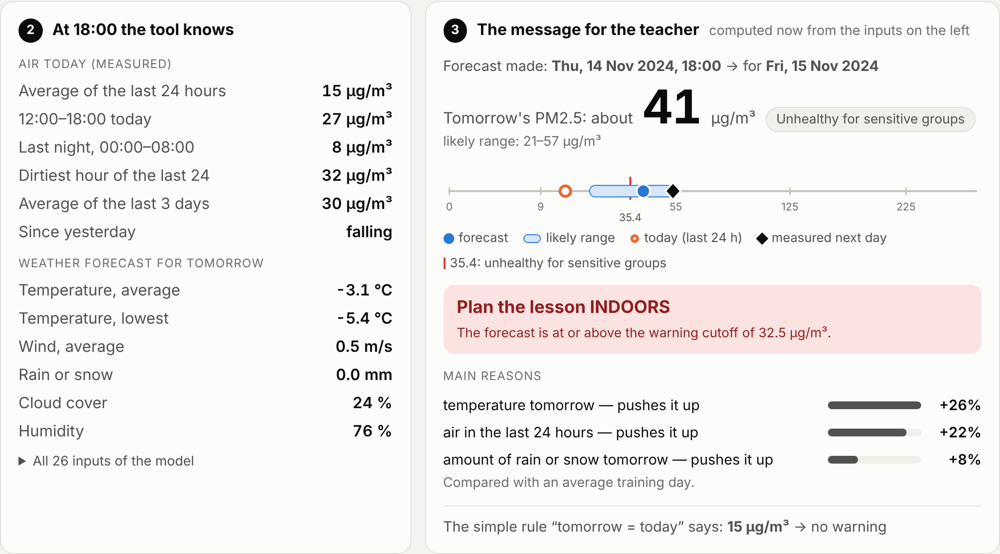
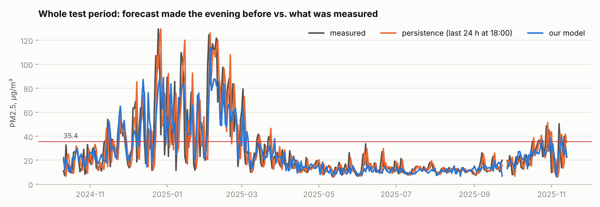
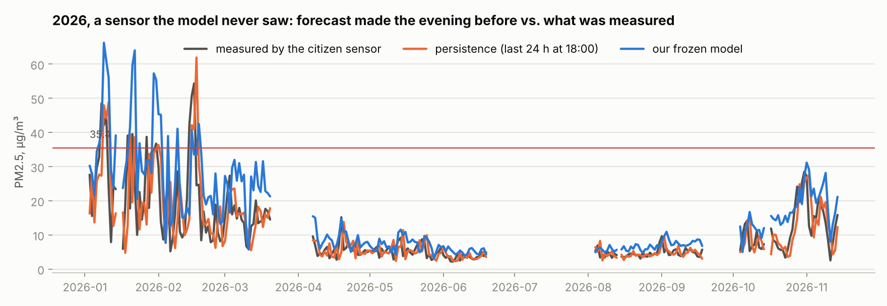

# Smog Tomorrow? An evening forecast for outdoor PE lessons in Almaty

**Track:** AI + Climate · **Team:** solo participant (name on the submission form)

**In one sentence:** on 216 winter days the model never saw, the forecast missed by 12.2 µg/m³ on average, against 17.0 for "tomorrow will be like today", and it raised 22 false alarms instead of 40. On a different sensor in 2026 it lost to the same baseline, and that is reported below too.

**Try it:** [`demo.html`](demo.html) is one file; download it and open it, and the model runs in your browser. ·
[Notebook with saved outputs](almaty_smog_tomorrow.ipynb) ·
[open in Google Colab](https://colab.research.google.com/github/yk59m2cmhw-hash/c/blob/claude/keen-bohr-rsb2xk/almaty_smog_tomorrow.ipynb) ·
every number below is saved in [`results/metrics.json`](results/metrics.json)

## The problem

Almaty lies in a basin under the mountains, and in winter polluted air gets trapped over the city. In the test data the air was "unhealthy for sensitive groups" or worse on 88 of 216 October–March days. A PE teacher has to decide the evening before whether tomorrow's lesson can be outdoors. The usual guess, "tomorrow will be like today", fails exactly when it matters: on the first day of a smog episode and on the first clean day after one.

## What we built

**In:** PM2.5 readings up to 18:00 today and tomorrow's weather forecast.
**Out:** tomorrow's average PM2.5 with a likely range, an "outdoors or indoors" advice and the main reasons. A second step plans the week: each evening it says "outdoors tomorrow" only if tomorrow is forecast to be among the cleanest days still available that week.

*A replay of 14 November 2024, an evening from the test period. The air that day was clean (15 µg/m³), so "tomorrow = today" gave no warning. The model warned. The next day measured 54 (black diamond).*

## What we added

Starting point: suggested project 4.3.2, Next-day air quality forecast. Added to it:

1. **A real clock.** The forecast is made at 18:00 from readings that existed then, and the baseline gets the same information.
2. **The days that matter.** Smog starts and clearings are scored separately.
3. **An action.** The week plan is scored by the air on the days the lessons took place, not by forecast error.
4. **A harder second test.** The finished model was run once on 2026 data from a different, low-cost sensor, under rules written down before the run.

## How it works

**Data.** Hourly PM2.5 from one reference-grade monitor in Almaty (OpenAQ location 8876), April 2020 – November 2025, and city weather from Open-Meteo. The record has gaps, and a day counts only if at least 18 of its 24 hours were measured. That leaves 1,282 evenings with inputs and an answer.

**Split by date, never shuffled.** Train to September 2023 (538 evenings), validation to September 2024 (348), test from 11 October 2024 to 13 November 2025 (396), scored once.

**Model.** A linear model (ridge regression) that predicts the logarithm of PM2.5 from 26 inputs: the air in the last hours and days, the season, and tomorrow's weather. It was chosen on two earlier winters by a rule written beforehand: take the simplest model unless a more complex one is more than 5% better. Gradient boosting was not.

## Results

| Forecast for tomorrow | Average error, Oct–Mar (µg/m³) | All days |
|---|---|---|
| Baseline "tomorrow = today": the last 24 hours at 18:00 | 17.0 | 10.9 |
| The same with today's full calendar day (knows 6 hours more than we do at 18:00) | 15.3 | 9.9 |
| **Our model** | **12.2** | **8.2** |

Our baseline scored 17.0 and our model 12.2 on held-out test data: 4.8 µg/m³ less error per day (95% interval 3.0 to 7.0).

- **As a warning** for "tomorrow above 35.4 µg/m³" (88 such days): the model caught 72 with 22 false alarms, the baseline 69 with 40. Both warning levels were set on the validation year by the same rule.
- **When smog starts** (31 days) the model warned on 17 and the baseline on 12. **When the air clears** (28 days) the baseline raised a false alarm on all 28, the model on 13.
- **Weather input.** The main test takes tomorrow's weather from the weather model's record of that day, as if the weather forecast were perfect. With real archived forecasts, issued one and two days earlier, the error stayed at 12.2 and 12.1.
- **The week plan** (29 school weeks, 2 outdoor lessons each): PM2.5 on lesson days was 40.0 with a fixed timetable and 35.4 with the plan, 4.6 cleaner (95% interval 0.8 to 8.8). Choosing the days with hindsight would give 26.7.

### Where it fails, and why we think so

- **On the dirtiest days.** On the 11 test days above 100 µg/m³ the forecast was on average 35 µg/m³ too low. The largest miss: 41 forecast, 98 measured (2 February 2025). Such days are rare in the training data, and a model fitted to the average error pulls its forecasts toward typical values. An extra input for the lid of warm air over the city (mountain minus city temperature) helped in one earlier winter and hurt in the other, so it was left out.
- **On a different sensor.** On a low-cost citizen sensor 2 km away, in 2026, the finished model lost to the baseline: 9.9 against 7.5 µg/m³ on Oct–Mar days. It had learned the level of its own monitor; this sensor reads about 0.68 times what the model expects. A school would need a few months of its own readings before it could trust the forecast.
- **During school hours.** The model forecasts the daily average, but the air between 08:00 and 18:00 is dirtier (51.8 against 39.1 µg/m³). Counted by school hours, the warning missed 34 of 115 bad days and the baseline 32, so there it has no advantage.
- **The week plan is not proven better than the same rule fed with the baseline** (35.4 against 37.5; the 95% interval of the difference, −1.3 to 5.9, includes zero).

## What we'd do next

1. Forecast school hours directly, and give the planner forecasts for the whole week.
2. Put a sensor at one school, collect one winter of readings, re-fit the model to it and try the warning with its PE teachers.

## Sources

- **Air data:** OpenAQ, [location 8876 "Almaty"](https://explore.openaq.org/locations/8876), provider AirNow, licence US Public Domain; from the [public OpenAQ archive](https://docs.openaq.org/aws/about).
- **Weather data:** [Open-Meteo](https://open-meteo.com/) Historical Weather API and Previous Runs API (ECMWF IFS), licence CC BY 4.0.
- **Global model used as an extra comparison:** CAMS global forecasts (Copernicus Atmosphere Monitoring Service) through the [Open-Meteo Air Quality API](https://open-meteo.com/en/docs/air-quality-api).
- **2026 sensor:** [sensor.community](https://sensor.community/) archive, SDS011 sensor no. 78340, licence ODbL.
- **Air categories:** [US EPA AQI fact sheet, 2024](https://www.epa.gov/system/files/documents/2024-02/pm-naaqs-air-quality-index-fact-sheet.pdf).
- **Libraries:** pandas, NumPy, scikit-learn, Matplotlib, requests; LightGBM was tried during development; jupytext and nbclient built the notebook; Playwright checks the demo page.
- **Starting point:** Veritas AI project brief 4.3.2.
- **AI tools:** Claude Code (Anthropic's AI coding agent). It did most of the engineering: it found the data sources, wrote the code and the demo page, ran the experiments and drafted this text. I set the task and its rules (one real user, public data only, a fair baseline, a test period locked before scoring, honest reporting of weak results), chose the Climate track, asked for the timetable step and reviewed the results.

A prototype, not health advice. One monitor is one point in the city.

---

# More checks and details

Everything below is extra material for a reader who wants to verify the write-up above.

## Run it yourself

- **Demo page.** Open `demo.html` in any browser; it needs no installation and no internet. It replays the held-out evenings: pick one, read the forecast, then reveal what was measured the next day. The page computes each forecast from the model's 26 weights. `node scripts/check_demo.js` confirms that this reproduces the notebook's forecast on all 396 held-out evenings (largest difference 0.008 µg/m³, the same warning decision on every day).
- **Notebook.** `pip install -r requirements.txt`, then open `almaty_smog_tomorrow.ipynb` and run all cells. It takes under a minute, reads the saved files in `data/raw/` and calls no API. No key and no GPU are needed.
- **Data.** How the raw files were downloaded: [`scripts/`](scripts/README.md).

## The other checks, in short

| Check | Result | Where |
|---|---|---|
| Is a free global air-quality model enough? | No. CAMS was off by 16.6 µg/m³ on Oct–Mar days and reads 10.7 too low here. With the plain rule "warn above 35.4" it caught 37 of 88 bad days; with a tuned warning level it caught 87 but warned on 153 of the 216 days. | notebook, section 9a |
| Real weather forecasts instead of the weather record | Error 12.2 (forecast one day old) and 12.1 (two days old); missed days 18 and 16; false alarms 22 and 21. The model was not retrained. | section 7 |
| A warning level tuned for school hours (validation year only) | The model missed 7 of 115 bad days with 61 false alarms; the baseline missed 19 with 55. A school that cares about lesson time should warn from a forecast of about 22 µg/m³, not 32.5. | section 9b |
| How was the model chosen? | On the winters of 2022/23 and 2023/24 only. Average error: baseline 21.1, ridge with air history 17.9, ridge with weather 13.7, boosting with weather 13.7. | section 5 |
| Does the likely range hold? | It was built to hold 80% of days and held 76% of the Oct–Mar test days. | section 6 |
| 2026, the other sensor: the week plan | Still 2.6 µg/m³ cleaner than a fixed timetable (95% interval 0.2 to 5.2, 15 weeks), because the rule only has to rank the days. | section 10 |
| 2026: is the failure a shift of level? | One correction number was fitted on January–March 2026 and checked on 40 later days. The error fell from 6.1 to 3.9 against 4.2 for the baseline. The remaining difference is too small to count (95% interval −1.0 to 1.7), and there was no bad day in those 40 days. | section 10 |

## Order of work

- Before the rules were fixed, a quick correlation check was run on all years, including the test period. No input was chosen because of it.
- The forecast test was run once. The timetable, the global-model comparison and the school-hours check came afterwards and did not change the model.
- The rules of each 2026 test were committed to git before its run (commits `dd8b550` and `62ff508`).
- The two instruments never ran at the same time, so we cannot tell whether the 2026 sensor reads low or the air was cleaner that year.
- The public record of the reference monitor ends on 14 November 2025. The demo therefore replays held-out days and is not a live forecast.
- More notes are at the end of the notebook. Process notes in Russian (protocol, requirements, status) are in [`docs/process_ru/`](docs/process_ru/).

## Files

| Path | What it is |
|---|---|
| `almaty_smog_tomorrow.ipynb` | the whole experiment, with saved outputs |
| `demo.html` | the demo page (one file) |
| `results/` | `metrics.json`, the model's weights, the forecasts for every test day, the figures |
| `data/raw/` | the downloaded data |
| `scripts/` | download scripts; `build_demo.py` and `check_demo.js` for the demo page |
| `docs/` | notes for the author, in Russian |
